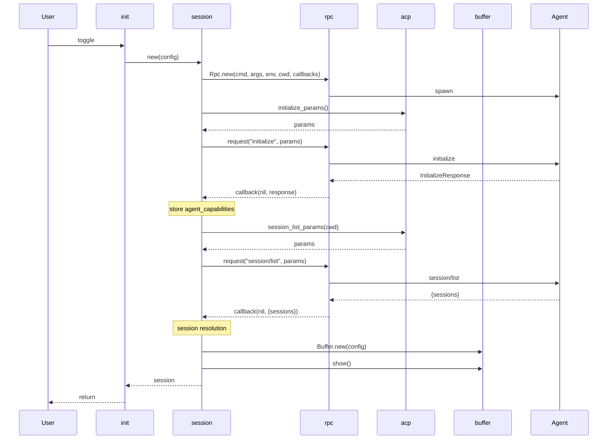
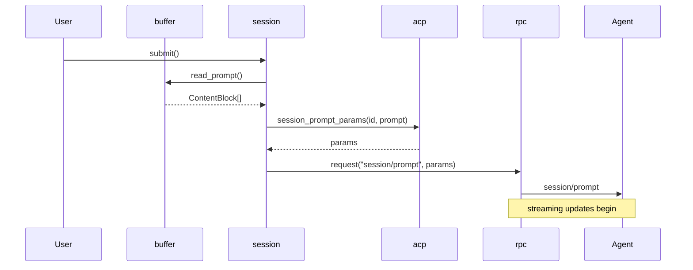
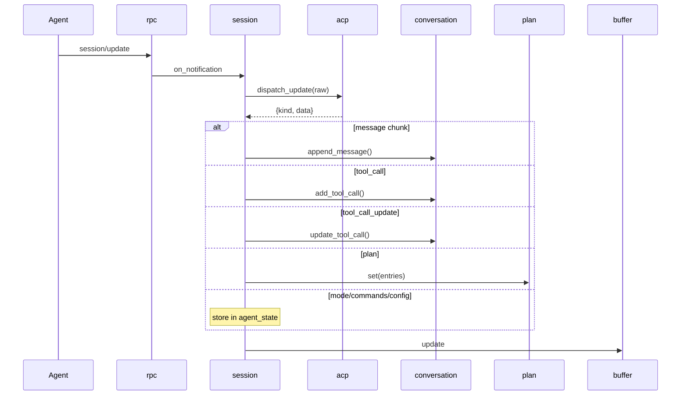
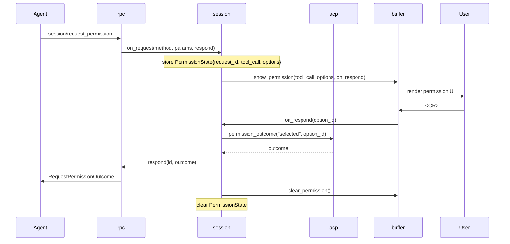

# Data Flow

How data moves through the plugin's modules during each major operation. Sequence diagrams show module-to-module calls; wire messages reference [ACP Messages](../research/acp-messages.md). Module signatures are in [Module Interfaces](module-interfaces.md), types in [Data Structures](data-structures.md), and the dependency graph in [Module Decomposition](module-decomposition.md).

## Lifecycle

### Startup

Two-phase startup: process spawn + session resolution. `init.toggle` (or any auto-start entry point) calls `Session.new(config)`, which orchestrates the full sequence.

Session resolution branches on the number of returned sessions:

- **0 sessions** — `acp.session_new_params(cwd)` → `rpc:request("session/new")` → store `session_id`, modes, config options.
- **1 session** — `acp.session_load_params(id, cwd)` → `rpc:request("session/load")` → store modes/config options, replay history into conversation.
- **N sessions** — `vim.ui.select` → user picks → same flow as 1 session.

### Shutdown

`:Symbiont stop` or `DirChanged` autocommand triggers teardown:

`init:stop()` → `session:stop()` → `rpc:shutdown()` → `buffer:destroy()`

`rpc:shutdown()` sends EOF on stdin, waits for process exit, fires `on_exit`. `buffer:destroy()` wipes the conversation and plan buffers.

## Conversation

### Prompt Submission

User writes a prompt in the buffer's prompt area and submits. When called from a non-conversation buffer with `opts`, `session:submit` writes the content to the prompt area first.

`session:submit` reads from `buffer:read_prompt()`, calls `acp.session_prompt_params(session_id, prompt)` to build the wire params, then calls `rpc:request("session/prompt", params, callback)`. The callback fires when the agent returns `stopReason`.

### Session Update Streaming

After `session/prompt`, the agent streams `session/update` notifications. `rpc` delivers each via `on_notification`; `session` discriminates the update kind via `acp.dispatch_update` and routes to the appropriate data module and buffer operation.

Update kind routing:

| Update kind | Data module call | Buffer operation |
|---|---|---|
| `user_message_chunk` | `conversation:append_message("user", data.content)` | `buffer:update_conversation(blocks)` |
| `agent_message_chunk` | `conversation:append_message("assistant", data.content)` | `buffer:update_conversation(blocks)` |
| `agent_thought_chunk` | `conversation:append_message("thought", data.content)` | `buffer:update_conversation(blocks)` |
| `tool_call` | `conversation:add_tool_call(data)` | `buffer:update_conversation(blocks)` |
| `tool_call_update` | `conversation:update_tool_call(data)` | `buffer:patch_tool_call(block)` |
| `plan` | `plan:set(data.entries)` | `buffer:update_plan(entries)` |
| `current_mode_update` | `agent_state.current_mode_id = data.current_mode_id` | — |
| `available_commands_update` | `agent_state.available_commands = data.available_commands` | — |
| `config_option_update` | `agent_state.config_options = data.config_options` | — |

Key distinction: `tool_call` and message chunks trigger `buffer:update_conversation`, which re-renders all blocks via `render.conversation` and replaces the conversation region. `tool_call_update` triggers `buffer:patch_tool_call`, which re-renders only the affected tool call block via `render.tool_call` and patches it in place using extmark ranges — avoiding a full re-render during high-frequency streaming.

### Permission Flow

The agent sends `session/request_permission` as a JSON-RPC request (not a notification) — the plugin must respond with a `RequestPermissionOutcome`.

Cancellation path: if the user calls `session:cancel` while a permission request is pending, `session` responds with `acp.permission_outcome("cancelled")` via `rpc:respond` before sending `session/cancel`.

## Commands

### Session Switch

`:Symbiont switch` → `init:switch()` → `session:switch()`:

1. `acp.session_list_params(cwd)` → `rpc:request("session/list")` → receive `SessionInfo[]`
2. Branch on count:
   - **1 session** — no-op (already loaded)
   - **2 sessions** — swap to the other session directly
   - **3+ sessions** — `vim.ui.select` → user picks
3. `acp.session_load_params(session_id, cwd)` → `rpc:request("session/load")`
4. `conversation:clear()` + `plan:clear()` + `buffer:update_conversation({})` — wipe current state
5. Replay returned history into conversation (reuses `append_message`/`add_tool_call` codepath)
6. `buffer:update_conversation(blocks)` — render replayed conversation

### Append

`:Symbiont append` → `init:append(opts)` → `session:append(opts)`:

1. Build a `ResourceLink` `ContentBlock` from the selected range/buffer
2. `buffer:write_prompt(content)` — insert the resource link into the prompt area

No RPC call — append only stages content locally for the next submit.

### Cancel

`:Symbiont cancel` → `init:cancel()` → `session:cancel()`:

1. If `permission` state exists: `acp.permission_outcome("cancelled")` → `rpc:respond(request_id, outcome)` → `buffer:clear_permission()` → clear `PermissionState`
2. `acp.session_cancel_params(session_id)` → `rpc:notify("session/cancel", params)`

`session/cancel` is a notification (fire-and-forget), not a request.

## Cross-Cutting

### vim.schedule Boundary

All `rpc` callbacks fire on `vim.schedule` — this is where the async boundary lives. Everything downstream of an `on_notification` or `on_request` callback runs on the main Neovim event loop. No concurrent buffer mutations are possible; session's routing logic and buffer writes are inherently serialized.

### Render Path

Two distinct paths from data to pixels:

- **Full re-render** (`buffer:update_conversation`): calls `render.conversation(blocks)` → replaces all lines above the prompt separator. Used for message chunks, new tool calls, and session load replay.
- **Extmark patch** (`buffer:patch_tool_call`): calls `render.tool_call(block)` → replaces only the lines within the tool call's extmark range. Used for `tool_call_update` streaming. Avoids re-rendering the entire conversation on every status or content change.
